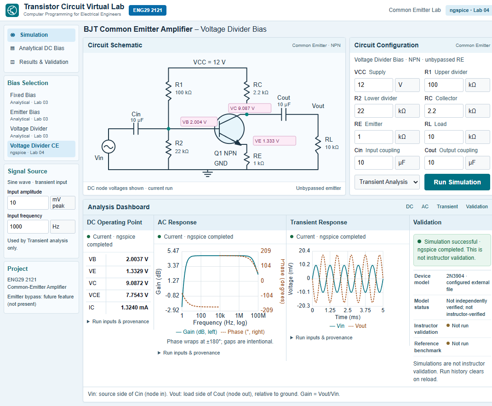
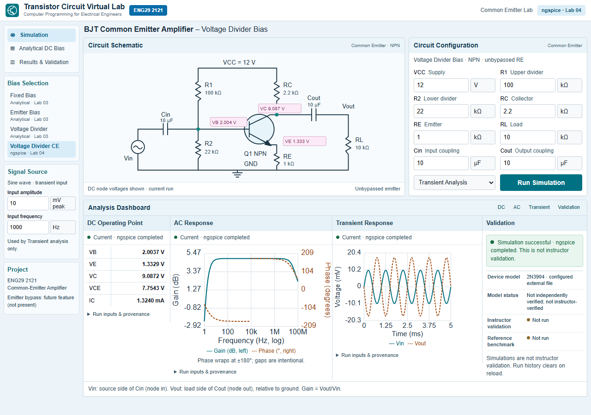
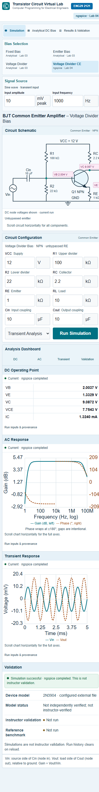

# ENG29 2121 — BJT Amplifier Lab (Lab 04)

A local Flask dashboard for learning and checking NPN common-emitter bias. It keeps the Lab 03 analytical calculators separate from a reference-circuit simulator that runs a real ngspice process. The simulator is a teaching aid, not instructor validation or a general-purpose circuit editor.

## Supported features

- Analytical DC bias calculations for Fixed, Emitter and Voltage Divider bias, with unit conversion, field validation, result tables and operating-region warnings.
- ngspice operating-point (DC), logarithmic AC sweep and transient analyses for the Lab 04 unbypassed voltage-divider CE reference circuit.
- Real returned solver data shown in the circuit schematic, dashboard and plots. DC reports VB, VE, VC, VCE and Q1 IC; AC plots gain and phase; transient plots Vin and Vout.
- Per-analysis retained results, explicit current/stale/error states and solver provenance (inputs, netlist, model status and log). Results are in-memory/document-local and clear on reload.
- Responsive desktop and narrow-screen layout. Narrow charts can be scrolled inside their chart regions.

Not implemented: arbitrary circuit editing, instructor-certified device models, Final Project bypass controls/overlays, save/export, persistent run history or reference-benchmark validation. The dashboard labels the emitter bypass feature as not present.

## Requirements

- Python 3.10+ (verified in this worktree with Python 3.12).
- Flask 3.x (`requirements.txt` declares `Flask>=3.0,<4.0`).
- ngspice executable for DC/AC/transient runs. This project does not install or bundle ngspice. The current Windows default is `C:\ngspice\Spice64\bin\ngspice_con.exe`; set `NGSPICE_PATH` for another executable.
- A compatible local 2N3904 SPICE model. Set `BJT_MODEL_PATH` to its file path. A Virginia Tech OPEL 2N3904 model has been used as a **fallback only; it is not instructor-verified**. Obtain the model yourself and check its license/redistribution terms. It is not included in this repository; do not redistribute or commit it without permission. The configured model file is copied into a temporary run directory and passed to ngspice, so only use a trusted file.

The analytical modes do not require ngspice or a model. Simulation integration tests are skipped if `BJT_MODEL_PATH` is unset.

## Setup

Clone/open this repository and work from its root. Create a virtual environment:

```powershell
# Windows PowerShell
python -m venv .venv
.\.venv\Scripts\Activate.ps1
```

```bash
# macOS / Linux
python3 -m venv .venv
source .venv/bin/activate
```

Install the declared Python dependency (when network/package access is approved):

```bash
python -m pip install -r requirements.txt
```

Install ngspice separately using its official distribution for your platform. Then configure both paths in the same shell used to launch Python. PowerShell example:

```powershell
$env:NGSPICE_PATH = 'C:\path\to\ngspice.exe'
$env:BJT_MODEL_PATH = 'C:\path\to\2N3904.lib'
```

Environment variables:

| Variable | Required for | Default / behavior |
|---|---|---|
| `NGSPICE_PATH` | All real SPICE analyses | Windows executable path above; must point to an executable file. |
| `BJT_MODEL_PATH` | All real SPICE analyses | No default model; must point to a readable compatible model file. |

The variables are process environment settings, not a checked-in `.env` file. `.env` files are ignored by Git.

## Run the application

```bash
python -m flask --app app run
```

Open <http://127.0.0.1:5000/>. Select an analytical bias mode from the navigation, or open **Voltage Divider CE / ngspice · Lab 04** for simulation. Select DC, AC or transient, edit the circuit/source fields as needed and choose **Run Simulation**. Stop the local development server with `Ctrl+C`.

For another port, for example:

```bash
python -m flask --app app run --port 5001
```

The Flask development server is for local coursework use only; it is not hardened or configured for public deployment.

The adapter may also be called from Python with `spice_engine.simulate('dc'|'ac'|'tran', values=None)`. Circuit values are SI units: volts, ohms, farads, peak volts and hertz. The UI converts its displayed units before calling the adapter. AC is V(out)/V(in), with `in` on the source side of Cin and `out` on the load side of Cout. Transient duration is five input periods. See `spice_engine.py` for exact bounds and output fields.

## Screenshots (real browser captures)

These are actual screenshots of the implemented dashboard after successful DC, AC and transient runs, captured with Playwright MCP. They are not mockups.

| Viewport | Capture |
|---|---|
| 1085 × 613 |  |
| 1280 × 900 |  |
| 390 × 844 |  |

## Tests and validation

Run the complete test suite from the repository root:

```powershell
python -B -m unittest discover -s tests -v
```

To include real ngspice integration tests, configure `NGSPICE_PATH` and `BJT_MODEL_PATH` first. The suite covers the analytical calculations, routes/forms, input validation, solver failures/timeouts/parsing, retained/stale result behavior, chart data and integration paths. The recorded Phase 7 run found **51 tests, all passed with a local fallback model configured**. The final independent comparison summary and regression log are in [`docs/evidence/phase7/`](docs/evidence/phase7/); generated netlists, raw solver outputs, machine-specific paths, and the model are intentionally not published.

## Limitations and known qualifications

- The fallback 2N3904 model is not instructor-verified. Its results cannot establish instructor acceptance or match an instructor starter model.
- Analytical calculations assume simplified forward-active equations with fixed beta and VBE; warnings do not turn them into a full transistor model.
- The SPICE page models the specified unbypassed reference circuit only; it is not an arbitrary netlist editor.
- Simulation results/history are not persisted after reload. AC and transient runs use finite sampled arrays and are not a substitute for physical measurement.
- Playwright phone checks use desktop Chromium viewport emulation, not physical-device, touch, Safari/Firefox or assistive-technology testing. No full WCAG certification is claimed; see validation notes for readability/audit limitations.
- Local source review does not establish ngspice/model supply-chain trust. No project-level license file or model redistribution grant was established during this verification; clarify both before redistribution.

## Troubleshooting

| Symptom | Check |
|---|---|
| `ngspice executable not found` | Confirm ngspice is installed and `NGSPICE_PATH` points to the executable, not its containing folder. Set it in the same shell before starting Flask. |
| `2N3904 model not found` | Confirm `BJT_MODEL_PATH` points to an existing compatible `.lib` file and is set in the server's environment. The application does not download a model. |
| Simulation failed / timed out | Check the model is trusted and compatible, input values are in range, ngspice runs independently, and the model defines subcircuit/device name `2N3904`. Inspect the run's provenance/log disclosure; failed analyses do not count as successful results. |
| Real-solver tests are skipped | `BJT_MODEL_PATH` was not configured when Python/test process started; set it, then rerun the full suite. |
| Port 5000 is occupied | Start Flask with `--port 5001` (or another free port) and open that address. |
| Plot is wider than a phone screen | Horizontally scroll within the chart region; this is intentional to preserve plot detail. The page itself was checked for horizontal overflow at the recorded emulated viewport. |
| Previous results disappeared | Run history is document-local and intentionally clears after reload/navigation. |

## Repository and submission

Repository: <https://github.com/B6829292/BJT-Amplifier-Lab04>. The Lab 04 feature was submitted in [PR #1](https://github.com/B6829292/BJT-Amplifier-Lab04/pull/1) and merged into `main`.

| Reference | Commit |
|---|---|
| Feature commit | `a7c63e10e2f4ceac406b56876dc210dbae2faa3c` |
| PR #1 merge commit on `main` | `ee2f3a4b7a1c68aebee727e1b0159d2ee73fb92f` |

The merge records the submitted feature; it does not certify the external BJT model. The fallback 2N3904 remains not instructor-verified, and its redistribution terms remain unresolved.
