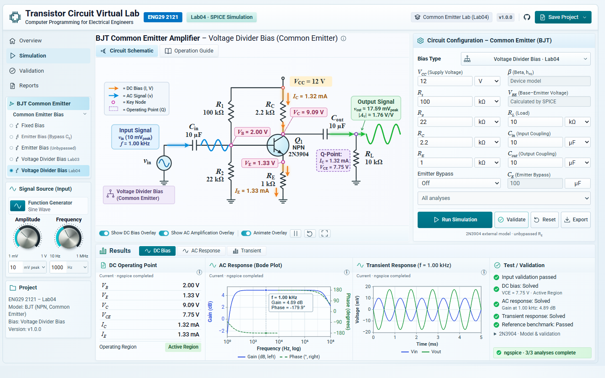
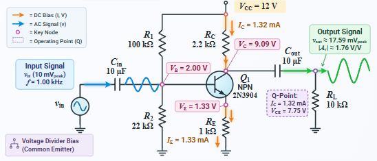
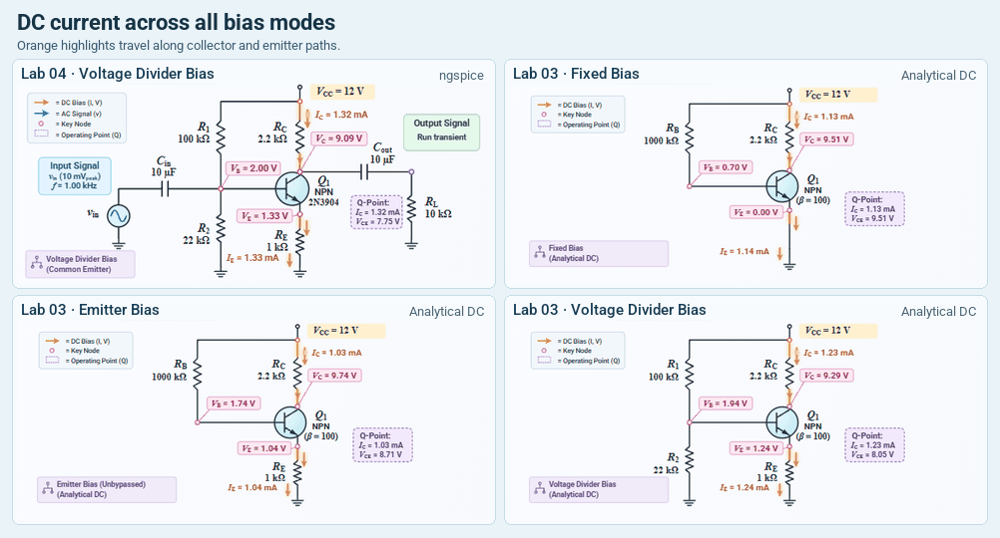
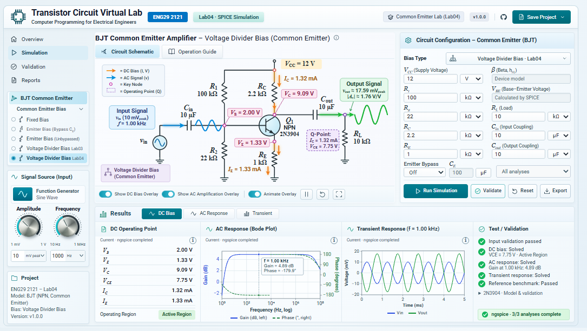
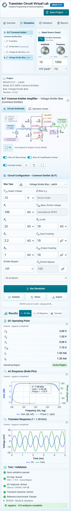

# ⚡ ENG29 2121 — BJT Amplifier Lab 04

### 🔬 ระบบวิเคราะห์และจำลองวงจรขยายสัญญาณ BJT ด้วย Flask และ ngspice

**BJT Amplifier Simulator** คือเว็บแอปพลิเคชันสำหรับศึกษา วิเคราะห์ และจำลองการทำงานของวงจรทรานซิสเตอร์ชนิด NPN โดยพัฒนาด้วย **Python Flask** และใช้ **ngspice** เป็นเครื่องมือจำลองวงจรไฟฟ้า

โปรเจกต์นี้ต่อยอดจาก Lab 03 โดยแยกการคำนวณเชิงวิเคราะห์ (Analytical Calculation) ออกจากการจำลองวงจรจริงด้วย SPICE เพื่อช่วยให้ผู้เรียนสามารถศึกษา เปรียบเทียบ และทำความเข้าใจพฤติกรรมของวงจรขยายสัญญาณแบบ Common-Emitter (CE) ได้สะดวกยิ่งขึ้น

> 📌 โปรแกรมนี้จัดทำขึ้นเพื่อศึกษาและทดลองวงจร BJT แบบ Common-Emitter ใน Lab 03 และ Lab 04

---

## 📌 สารบัญ

1. [🌟 ความสามารถของระบบ](#-ความสามารถของระบบ)
2. [🖥️ ภาพตัวอย่างโปรแกรม](#️-ภาพตัวอย่างโปรแกรม)
3. [🛠️ สิ่งที่ต้องติดตั้ง](#️-สิ่งที่ต้องติดตั้ง)
4. [🚀 วิธีติดตั้งและเริ่มใช้งาน](#-วิธีติดตั้งและเริ่มใช้งาน)
5. [📊 การวิเคราะห์และจำลองวงจร](#-การวิเคราะห์และจำลองวงจร)
6. [🧪 การทดสอบและตรวจสอบความถูกต้อง](#-การทดสอบและตรวจสอบความถูกต้อง)
7. [⚠️ ข้อจำกัดของระบบ](#️-ข้อจำกัดของระบบ)
8. [🔧 การแก้ไขปัญหาเบื้องต้น](#-การแก้ไขปัญหาเบื้องต้น)
9. [📦 Repository และประวัติการส่งงาน](#-repository-และประวัติการส่งงาน)

---

## 🌟 ความสามารถของระบบ

### 🧮 1. การคำนวณ DC Bias — Lab 03

รองรับการวิเคราะห์วงจรไบอัสทรานซิสเตอร์ 3 รูปแบบ ได้แก่

- **Fixed Bias** — วงจรไบอัสแบบคงที่
- **Emitter Bias (Unbypassed)** — วงจรไบอัสที่มีตัวต้านทานอิมิตเตอร์โดยไม่มีตัวเก็บประจุบายพาส
- **Voltage Divider Bias** — วงจรไบอัสแบบแบ่งแรงดัน

ความสามารถของส่วนนี้ประกอบด้วย

- ✅ รับค่าอุปกรณ์และแปลงหน่วยอัตโนมัติ
- ✅ ตรวจสอบความถูกต้องของข้อมูลที่กรอก
- ✅ คำนวณค่าทางไฟฟ้าจากสมการเชิงวิเคราะห์
- ✅ แสดงผลในรูปแบบตาราง
- ✅ แจ้งเตือนสถานะการทำงานของทรานซิสเตอร์
- ✅ แสดงลูกศรและแอนิเมชันกระแส DC เมื่อคำนวณได้จุดทำงานในย่าน Active Region

### ⚡ 2. การจำลองวงจรด้วย ngspice — Lab 04

จำลองวงจรขยายสัญญาณ **Common-Emitter แบบ Voltage Divider Bias** โดยใช้ทรานซิสเตอร์ 2N3904 ใน Lab 04 ค่าเริ่มต้นคือ **Emitter Bypass: Off** หากต้องการทดลองแบบบายพาส ให้เลือก **On** และกำหนดค่า `C_E` หน่วย µF ค่าเริ่มต้นของตัวเก็บประจุคือ **100 µF**

รองรับการวิเคราะห์ 3 ประเภท

| ประเภท | รายละเอียด |
|---|---|
| 🔋 DC Operating Point | วิเคราะห์แรงดันและกระแส ณ จุดทำงานของวงจร |
| 📈 AC Analysis | วิเคราะห์อัตราขยายและเฟสของสัญญาณตามความถี่ |
| 🌊 Transient Analysis | วิเคราะห์รูปคลื่นแรงดันอินพุตและเอาต์พุตตามเวลา |

### 📊 3. Dashboard และกราฟแสดงผล

หน้า Simulation ของ Lab 04 แสดงแผนภาพวงจรและผลที่คำนวณจาก ngspice ผู้ใช้ปรับแอมพลิจูดและความถี่ของสัญญาณอินพุตได้จาก Function Generator แล้วเลือกวิเคราะห์ DC, AC, Transient หรือทั้งสามแบบด้วยปุ่ม **Run Simulation**

ใต้ปุ่มหมุน Amplitude เลือก `µV peak`, `mV peak` หรือ `V peak` ได้ ส่วน Frequency เลือก `Hz`, `kHz` หรือ `MHz` ได้ เมื่อเปลี่ยนหน่วย ตัวเลขจะถูกแปลงให้เป็นสัญญาณเดิม เช่น `1000 Hz` จะกลายเป็น `1 kHz`

- **DC Bias Overlay** แสดงลูกศรสีส้มตามทิศทางกระแส `IC` และ `IE` พร้อมแรงดันที่ขา `VB`, `VC`, `VE` และจุดทำงาน Q-Point จากผล DC ใช้รูปแบบลูกศรและปุ่มควบคุมแอนิเมชันเดียวกันทั้ง Lab 03 และ Lab 04
- **AC Amplification Overlay** แสดงรูปคลื่นอินพุตสีน้ำเงินและเอาต์พุตสีเขียวจากผล Transient ผู้ใช้เปิดหรือปิดแต่ละ Overlay รวมถึงหยุดชั่วคราว เล่นต่อ หรือเริ่มแอนิเมชันใหม่ได้

**DC Analysis**

แสดงค่าทางไฟฟ้าที่สำคัญ เช่น

- `VB` — แรงดันที่ขา Base
- `VE` — แรงดันที่ขา Emitter
- `VC` — แรงดันที่ขา Collector
- `VCE` — แรงดันระหว่าง Collector และ Emitter
- `IC` — กระแสที่ขา Collector
- `IE` — กระแสที่ขา Emitter

**AC Analysis**

แสดงกราฟการตอบสนองเชิงความถี่ ประกอบด้วย

- 📈 Voltage Gain (dB)
- 📉 Phase Shift (Degrees)
- 🔍 การเปลี่ยนแปลงอัตราขยายและเฟสตามความถี่
- 📍 จุดอ่านค่า Gain และ Phase บนกราฟ Bode จะตามความถี่ใน Function Generator

**Transient Analysis**

แสดงรูปคลื่นแรงดันตามเวลา ได้แก่

- `Vin` — สัญญาณขาเข้า
- `Vout` — สัญญาณขาออก

### 🧠 4. การจัดการผลการจำลอง

- ✅ เก็บผล DC, AC และ Transient แยกจากกันระหว่างที่เปิดหน้าเว็บ
- ✅ แสดงสถานะ `Current`, `Stale` และ `Failed`
- ✅ แสดงอินพุตที่ใช้ในการจำลองแต่ละครั้ง
- ✅ สามารถตรวจสอบ Netlist และ Log จาก ngspice
- ✅ แจ้งเตือนเมื่อผลการจำลองไม่ตรงกับค่าปัจจุบัน
- ✅ ดาวน์โหลดผลการจำลองและค่าที่ใช้ด้วย **Export** หรือรวมการตั้งค่า Overlay ด้วย **Save Project** ในรูปแบบ JSON
- ✅ ตรวจอินพุตและผลการจำลองอัตโนมัติ ปุ่ม **Validate** ใช้ตรวจซ้ำได้ แผง **Model & Validation** ระบุแหล่งโมเดลและสถานะการโหลดด้วย ngspice
- ✅ **Reference Benchmark** เปรียบเทียบผลกับ ngspice ที่รันแยกกันโดยใช้ค่าตั้งต้นแบบไม่บายพาสและโมเดล 2N3904 ตรงกับชุดอ้างอิง เกณฑ์คือคลาดเคลื่อนไม่เกิน 5% [รายละเอียดชุดอ้างอิง](docs/validation.md)

> 💡 หน้าเว็บเก็บผลการจำลองไว้ระหว่างใช้งาน หากต้องการเก็บผลก่อนรีโหลดหรือออกจากหน้า ให้ดาวน์โหลดไฟล์ JSON

### 📱 5. Responsive Web Design

หน้า Dashboard ออกแบบให้ใช้งานได้ทั้งบนคอมพิวเตอร์และหน้าจอขนาดเล็ก

บนหน้าจอแคบ แผงควบคุมและผลลัพธ์เรียงในแนวตั้ง หน้า Lab 04 ใช้ **Fit** แสดงแผนภาพวงจรครบในจอ กด **Expand** หรือปิด **Fit** แล้วเลื่อนแนวนอนภายในแผงเพื่ออ่านรายละเอียด

---

## 🖥️ ภาพตัวอย่างโปรแกรม

ภาพจากหน้า Simulation ของ Lab 04 แสดงวงจรขยาย Common-Emitter แบบ Voltage Divider Bias ที่ใช้ทรานซิสเตอร์ 2N3904 และตัวต้านทานอิมิตเตอร์แบบไม่บายพาส จับภาพด้วย **Playwright MCP** หลังจาก ngspice คำนวณผล DC, AC และ Transient สำเร็จ

### 💻 Desktop — 1440 × 900



### 🔍 วงจรและจุดทำงาน Q-Point



ลูกศรสีส้มแสดงทิศทางกระแสตามขา Collector และ Emitter กล่อง Q-Point สีม่วงอยู่ข้างขา Emitter และแสดง `IC` กับ `VCE` จากผล DC ของรอบที่จับภาพ [ดูภาพเทียบกับ Final Project Reference](docs/evidence/schematic-fidelity/current-q-point-comparison.png)

### 🎞️ แอนิเมชันกระแส DC ทั้งสี่หน้าวงจร



Lab 03 แสดงลูกศรหลังคำนวณได้จุดทำงานในย่าน Active Region เมื่อเปิดการลดการเคลื่อนไหว ลูกศรและค่ากระแสยังดูได้ตามปกติ

### 🧪 Emitter Bypass และการตรวจผล

ที่ค่าตั้งต้นของวงจรและความถี่ 1 kHz ผล ngspice ให้ Gain **4.89 dB** เมื่อปิด Emitter Bypass และ **38.84 dB** เมื่อเปิดด้วย `C_E = 100 µF` [ภาพหน้าจอขณะเปิด Emitter Bypass](docs/screenshots/lab04-bypass.png) · [ภาพแผง Model & Validation](docs/screenshots/lab04-model-validation.png)

### 🖥️ Compact Desktop — 1085 × 613



### 📱 Mobile View — 390 × 844



> 📷 ภาพมือถือเป็นภาพเต็มหน้าจาก Chromium ที่จำลอง viewport ขนาด 390 × 844

---

## 🛠️ สิ่งที่ต้องติดตั้ง

ก่อนเริ่มใช้งาน ควรเตรียมเครื่องมือดังต่อไปนี้

| เครื่องมือ | ข้อกำหนด | หน้าที่ |
|---|---|---|
| 🐍 Python | 3.10 ขึ้นไป | ประมวลผลโปรแกรม |
| 🌐 Flask | 3.x | สร้างเว็บแอปพลิเคชัน |
| ⚡ ngspice | ติดตั้งแยกต่างหาก | จำลองวงจรไฟฟ้า |
| 🔬 2N3904 SPICE Model | โมเดลที่เข้ากันได้ | กำหนดคุณลักษณะทรานซิสเตอร์ |
| 💻 Web Browser | เบราว์เซอร์ที่รองรับ | แสดง Dashboard |

เวอร์ชัน Python ที่ใช้ตรวจสอบโปรเจกต์คือ **Python 3.12**

### ⚠️ ข้อควรทราบเกี่ยวกับโมเดล 2N3904

โปรเจกต์นี้ใช้โมเดล **Virginia Tech OPEL 2N3904** เป็นโมเดลสำรองสำหรับการทดสอบ

- โปรเจกต์เลือกใช้โมเดลนี้สำหรับการทดลองและเป็นฐานของ Reference Benchmark
- ไม่มีไฟล์โมเดลรวมอยู่ใน Repository
- ผู้ใช้งานต้องจัดหาโมเดลที่เข้ากันได้ด้วยตนเอง
- ควรตรวจสอบสิทธิ์การใช้งานและการเผยแพร่ก่อนนำโมเดลไปแจกจ่าย
- ควรใช้เฉพาะไฟล์โมเดลจากแหล่งที่เชื่อถือได้

**หมายเหตุ:** การคำนวณ Analytical DC Bias สามารถใช้งานได้โดยไม่ต้องติดตั้ง ngspice หรือโมเดล SPICE

---

## 🚀 วิธีติดตั้งและเริ่มใช้งาน

### 📥 ขั้นตอนที่ 1 — ดาวน์โหลดโปรเจกต์

Clone Repository จาก GitHub

```bash
git clone https://github.com/B6829292/BJT-Amplifier-Lab04.git
```

เข้าไปยังโฟลเดอร์โปรเจกต์

```bash
cd BJT-Amplifier-Lab04
```

### 🐍 ขั้นตอนที่ 2 — สร้าง Virtual Environment

**สำหรับ Windows PowerShell**

```powershell
python -m venv .venv
.\.venv\Scripts\Activate.ps1
```

**สำหรับ Linux / macOS**

```bash
python3 -m venv .venv
source .venv/bin/activate
```

### 📦 ขั้นตอนที่ 3 — ติดตั้ง Dependencies

ติดตั้งไลบรารี Python ที่ระบุใน `requirements.txt`

```bash
python -m pip install -r requirements.txt
```

Dependency หลักของโปรเจกต์คือ Flask โดยกำหนดเวอร์ชันไว้ดังนี้

```text
Flask>=3.0,<4.0
```

### ⚡ ขั้นตอนที่ 4 — ตั้งค่า ngspice และโมเดล BJT

ติดตั้ง ngspice แยกต่างหาก จากนั้นตั้งค่า Environment Variables ให้ชี้ไปยังไฟล์ที่ใช้จริง

ตัวอย่างสำหรับ Windows PowerShell

```powershell
$env:NGSPICE_PATH = 'C:\path\to\ngspice.exe'
$env:BJT_MODEL_PATH = 'C:\path\to\2N3904.lib'
```

เปลี่ยนเส้นทางตัวอย่างให้ตรงกับตำแหน่งไฟล์ในเครื่องของตนเอง

| Environment Variable | รายละเอียด |
|---|---|
| `NGSPICE_PATH` | ตำแหน่งไฟล์โปรแกรม ngspice |
| `BJT_MODEL_PATH` | ตำแหน่งไฟล์โมเดล 2N3904 |

ค่าพื้นฐานของไฟล์ ngspice บน Windows ในโปรเจกต์คือ

```text
C:\ngspice\Spice64\bin\ngspice_con.exe
```

หากติดตั้งไว้ที่ตำแหน่งอื่น ต้องกำหนด `NGSPICE_PATH` ใหม่

> 🔐 โปรเจกต์ไม่ได้จัดเก็บค่าตัวแปรเหล่านี้ไว้ในไฟล์ `.env` ที่ Commit ขึ้น GitHub และมีการตั้งค่า `.gitignore` เพื่อป้องกันไฟล์ `.env` ถูกเพิ่มเข้าสู่ Repository

### ▶️ ขั้นตอนที่ 5 — เริ่มต้น Flask Server

ใช้คำสั่ง

```bash
python -m flask --app app run
```

จากนั้นเปิดเว็บเบราว์เซอร์แล้วเข้าสู่

**http://127.0.0.1:5000/**

หรือเปิดหน้าจำลอง Lab 04 โดยตรงที่

**http://127.0.0.1:5000/simulation**

หากต้องการเปลี่ยนพอร์ต เช่น พอร์ต 5001

```bash
python -m flask --app app run --port 5001
```

เมื่อใช้งานเสร็จ กด `Ctrl+C` ใน Terminal เพื่อหยุด Server

### 🔬 ทดลองใช้งาน

1. ใน Lab 03 เลือกวงจรไบอัสและกด **Calculate DC Bias** เพื่อดูจุดทำงานและลูกศรกระแส
2. ใน Lab 04 กด **Run Simulation** เพื่อดูผลครบทั้ง DC, AC และ Transient ลองเปลี่ยน **Emitter Bypass** เป็น **On** แล้วจำลองอีกครั้งเพื่อเทียบ Gain และรูปคลื่น
3. เปิด **Model & Validation** เพื่อดูชื่อโมเดล สถานะ `Loaded by ngspice` และผล Reference Benchmark เมื่อใช้ชุดตั้งต้นที่ตรงกับโมเดลอ้างอิง

> ⚠️ Flask Development Server เหมาะสำหรับการเรียนและการทดสอบภายในเครื่อง ไม่ได้ตั้งค่าให้ปลอดภัยเพียงพอสำหรับเปิดให้บริการสาธารณะบนอินเทอร์เน็ต

---

## 📊 การวิเคราะห์และจำลองวงจร

### 🔋 DC Operating Point

ใช้วิเคราะห์แรงดันและกระแสที่จุดทำงานของทรานซิสเตอร์ โดยแสดงผลผ่าน Dashboard และตำแหน่งต่าง ๆ บนแผนภาพวงจร

ค่าที่แสดงประกอบด้วย `VB`, `VE`, `VC`, `VCE`, `IC` และ `IE` พร้อมสถานะการทำงานของทรานซิสเตอร์

### 📈 AC Frequency Response

ใช้วิเคราะห์การตอบสนองของวงจรเมื่อความถี่เปลี่ยนแปลง

อัตราขยายคำนวณจากอัตราส่วนของแรงดันเอาต์พุตและอินพุต

```text
Voltage Gain (dB) = 20 log10(|Vout / Vin|)
```

ระบบแสดงกราฟ Gain และ Phase ตามความถี่ โดยกำหนดให้

- `Vin` วัดจากด้านแหล่งสัญญาณก่อนตัวเก็บประจุ Cin
- `Vout` วัดจากด้านโหลดหลังตัวเก็บประจุ Cout

### 🌊 Transient Response

ใช้วิเคราะห์การเปลี่ยนแปลงของแรงดันตามเวลา

ผู้ใช้สามารถกำหนด Amplitude และ Frequency ของสัญญาณอินพุตได้ โดยระบบแสดงรูปคลื่น `Vin` และ `Vout` เพื่อศึกษาพฤติกรรมของวงจรขยายแบบ Common-Emitter

ระยะเวลาการจำลองกำหนดให้ครอบคลุม **5 คาบของสัญญาณอินพุต**

### 🧩 การเรียกใช้ Simulation Engine ผ่าน Python

สามารถเรียกใช้ฟังก์ชันจาก `spice_engine.py` ได้โดยตรง เช่น

```python
import spice_engine

dc_result = spice_engine.simulate('dc')
ac_result = spice_engine.simulate('ac')
tran_result = spice_engine.simulate('tran')
bypassed_ac = spice_engine.simulate('ac', {'ce': 100e-6})
```

ค่าพารามิเตอร์ของ Engine ใช้หน่วย SI เช่น

- แรงดัน: V
- ความต้านทาน: Ω
- ความจุไฟฟ้า: F
- แอมพลิจูด: V peak
- ความถี่: Hz

ระบบหน้าเว็บจะทำหน้าที่แปลงหน่วยที่ผู้ใช้กรอกก่อนส่งให้ Simulation Engine

---

## 🧪 การทดสอบและตรวจสอบความถูกต้อง

โปรเจกต์มีชุดทดสอบอัตโนมัติเพื่อตรวจสอบการคำนวณ การรับข้อมูล การทำงานของ Flask และการประมวลผลผลจำลอง ngspice

### ▶️ วิธีรันทดสอบ

```powershell
python -B -m unittest discover -s tests -v
```

หากต้องการให้รวมการทดสอบที่เรียกใช้ ngspice จริง ต้องตั้งค่า `NGSPICE_PATH` และ `BJT_MODEL_PATH` ให้ถูกต้องก่อน

ชุดทดสอบส่วนที่เรียกใช้ JavaScript ต้องติดตั้ง Node.js ด้วย

### ✅ ผลการทดสอบเวอร์ชันปัจจุบัน

ชุดทดสอบ `unittest` ผ่าน **77 รายการ** ด้วย ngspice และโมเดล 2N3904 ที่ตั้งค่าไว้ ครอบคลุมการคำนวณ Lab 03 วงจร Lab 04 ทั้งเปิดและปิด `C_E` การแปลงหน่วย และการโหลดโมเดล

Playwright ผ่าน **6 ชุด** ครอบคลุมการสลับวงจรทั้งสี่หน้า การควบคุมแอนิเมชัน การแสดงผลบนเดสก์ท็อปและมือถือจำลอง และการส่งออก JSON

### 📋 บันทึกการทดสอบ Phase 7 ก่อนปรับหน้าจอ

| รายการ | ผลลัพธ์ |
|---|---|
| 🧪 Regression Tests | 51 ผ่าน |
| ❌ Failed Tests | 0 |
| ⏭️ Skipped Tests | 0 |
| 🌐 Browser Acceptance | B1–B8 ผ่าน |
| 📱 Responsive Viewports | 3 ขนาด |
| ⚡ Simulation Submissions | 27 ครั้ง |
| 🐛 Uncaught Page Errors | 0 |

การตรวจสอบครอบคลุมการคำนวณ Analytical DC Bias, ข้อมูลอินพุต, ข้อผิดพลาดจาก Solver, ผลการจำลอง DC/AC/Transient และสถานะของผลลัพธ์ที่เก็บไว้ระหว่างใช้งาน

มีการเปรียบเทียบผลจำลองกับการเรียก ngspice โดยตรงแยกจากแอปพลิเคชัน เพื่อใช้ตรวจสอบความสอดคล้องของข้อมูลและการแสดงกราฟ

> 📌 ผลการทดสอบข้างต้นบันทึกจากสภาพแวดล้อมที่ใช้โมเดล 2N3904 ของ Virginia Tech OPEL

### 📂 หลักฐานการทดสอบ

| ไฟล์ | รายละเอียด |
|---|---|
| [📄 Validation Report](docs/validation.md) | รายงานการตรวจสอบและรายละเอียดการทดสอบ |
| [📊 Summary JSON](docs/evidence/phase7/summary.json) | สรุปผลการทดสอบเชิงตัวเลข |
| [🧪 Regression Log](docs/evidence/phase7/regression.txt) | บันทึกผลการทดสอบอัตโนมัติ |
| [🖥️ ภาพหน้าจอปัจจุบัน](docs/screenshots/lab04-desktop.png) | หน้า Simulation ขนาด 1440 × 900 พร้อมผล DC, AC และ Transient |
| [🔍 ภาพเทียบวงจรกับต้นฉบับ](docs/evidence/schematic-fidelity/current-q-point-comparison.png) | ตำแหน่งลูกศรกระแสและกล่อง Q-Point เทียบกับภาพอ้างอิง |

ไฟล์ Netlist ที่สร้างระหว่างการทดสอบ ผลลัพธ์ดิบจาก Solver และไฟล์โมเดลภายนอกไม่ได้เผยแพร่ไว้ใน Repository

---

## ⚠️ ข้อจำกัดของระบบ

โปรเจกต์ถูกพัฒนาภายใต้ขอบเขตการทดลอง Lab 04 จึงมีข้อจำกัดดังต่อไปนี้

1. **โมเดลทรานซิสเตอร์** — ผลจำลองขึ้นกับไฟล์ 2N3904 ที่กำหนดผ่าน `BJT_MODEL_PATH` และ Reference Benchmark ใช้กับไฟล์ OPEL ในชุดอ้างอิง
2. **การจำลองวงจร** — Lab 04 รองรับ Common-Emitter แบบ Voltage Divider ที่เลือกเปิดหรือปิด Emitter Bypass ได้ ส่วน Lab 03 ใช้การคำนวณ DC เชิงวิเคราะห์
3. **การแก้ไขวงจร** — ไม่รองรับการสร้างหรือแก้ไขวงจรอิสระทุกชนิด
4. **การบันทึกข้อมูล** — ดาวน์โหลดผลเป็น JSON ได้ ประวัติในหน้าเว็บจะล้างเมื่อรีโหลด และยังไม่มีระบบนำเข้าไฟล์โครงการ
5. **ความแม่นยำของ Analytical Mode** — ใช้สมการประมาณภายใต้สมมติฐานค่า β และ VBE คงที่
6. **การทดสอบมือถือ** — ตรวจสอบผ่าน Chromium Viewport Emulation ยังไม่ได้ทดสอบบนอุปกรณ์มือถือจริง
7. **Accessibility** — ยังไม่ได้รับการตรวจสอบตามมาตรฐาน WCAG แบบครบถ้วน
8. **การเผยแพร่โปรเจกต์** — ยังไม่มี Project License และยังไม่ได้ยืนยันสิทธิ์ในการแจกจ่ายโมเดล SPICE

ฟีเจอร์เพิ่มเติมที่ยังไม่รองรับ ได้แก่

- Persistent Simulation History

---

## 🔧 การแก้ไขปัญหาเบื้องต้น

| ปัญหา | แนวทางแก้ไข |
|---|---|
| ❌ ไม่พบ ngspice | ตรวจสอบการติดตั้งและค่า `NGSPICE_PATH` |
| ❌ ไม่พบโมเดล 2N3904 | ตรวจสอบไฟล์ `.lib` และค่า `BJT_MODEL_PATH` |
| ⏳ Simulation Timeout | ตรวจสอบความถูกต้องของโมเดลและพารามิเตอร์ |
| ⏭️ Integration Tests ถูกข้าม | ตั้งค่า `BJT_MODEL_PATH` ก่อนรันทดสอบ |
| 🌐 Port 5000 ถูกใช้งาน | เปลี่ยนพอร์ตด้วย `--port 5001` |
| 📱 แผนภาพวงจรกว้างกว่าหน้าจอ | เลื่อนแนวนอนภายในแผง Circuit Schematic |
| 🔄 ต้องการเก็บผลการจำลองก่อน Refresh | กด **Export** เพื่อดาวน์โหลดผลเป็นไฟล์ JSON |

หาก ngspice แสดงข้อผิดพลาด สามารถเปิดดูข้อมูล Netlist และ Log ของการจำลองแต่ละครั้งจาก Dashboard เพื่อช่วยตรวจสอบสาเหตุได้

---

## 📦 Repository และประวัติการส่งงาน

### 🔗 GitHub Repository

**[B6829292/BJT-Amplifier-Lab04](https://github.com/B6829292/BJT-Amplifier-Lab04)**

ระบบ Lab 04 ถูกเพิ่มเข้าสู่ Branch หลัก `main` ผ่าน Pull Request และมีการปรับปรุงเอกสารประกอบภายหลัง

| รายการ | รายละเอียด |
|---|---|
| 🔬 Feature Commit | `a7c63e10e2f4ceac406b56876dc210dbae2faa3c` |
| 🔀 PR #1 Merge Commit | `ee2f3a4b7a1c68aebee727e1b0159d2ee73fb92f` |
| 📚 Documentation Commit | `a34c9c4a1a995a7d46edfcd738a6e1811b876d2c` |
| ✅ Post-Merge Documentation | `2ffb37f59129e818988cccbdfde7226382cdd4b0` |
| 🖥️ ปรับ Dashboard และแผนภาพวงจร | `4813d96486f94c033eb05c9d8afabd0cf08bf6ac` |

**ประวัติ Pull Request**

- [PR #1 — Lab 04 BJT Amplifier ngspice Simulator](https://github.com/B6829292/BJT-Amplifier-Lab04/pull/1)
- [PR #2 — Post-Merge Documentation Cleanup](https://github.com/B6829292/BJT-Amplifier-Lab04/pull/2)

---

## 🎓 สรุปโครงการ

**BJT-Amplifier-Lab04** เป็นโปรเจกต์เพื่อการศึกษาเกี่ยวกับวงจรขยายสัญญาณทรานซิสเตอร์ ที่ผสานการคำนวณเชิงทฤษฎีจาก Lab 03 เข้ากับการจำลองวงจรด้วย ngspice ใน Lab 04

ผู้ใช้งานสามารถศึกษาจุดทำงาน DC การตอบสนองเชิงความถี่ AC และรูปคลื่น Transient ผ่าน Dashboard พร้อมกราฟและข้อมูลจาก Simulation Engine จริง

โปรเจกต์มีเอกสารประกอบ ชุดทดสอบอัตโนมัติ และหลักฐานการตรวจสอบ เพื่อช่วยให้สามารถตรวจสอบการทำงานและนำไปศึกษาเพิ่มเติมได้

**⚡ Built with Python Flask & ngspice | ENG29 2121 — Lab 04**
